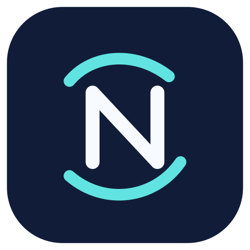

<h1>N-LIC · No Longer in Capsule</h1>
Open Android network filtering research fork

<a href="README.md">Русский</a> · English · <a href="README-tr.md">Türkçe</a>

> **EXPERIMENTAL — SECURITY REVIEW PENDING.** Early N-LIC APKs were blocked by Google Play Protect. The root cause is unknown. Do not disable device protections to install these builds. See [security audit](docs/security/SECURITY_AUDIT_20261103.md).

N-LIC is an independent open-source fork of [ByeByeDPI](https://github.com/romanvht/ByeByeDPI), based on [ByeDPI](https://github.com/hufrea/byedpi) and [hev-socks5-tunnel](https://github.com/heiher/hev-socks5-tunnel). It is not endorsed by the original authors.

It provides local traffic handling, Android VPN routing, a SOCKS proxy and strategy testing. **It is not a remote VPN; it does not inherently encrypt network traffic or hide your public IP.**

The independent N-LIC app name/icon and signing identities prevent confusion with the upstream release. A signing change does **not** prove the software safe or fix Play Protect classification.

- [Codespaces development signing](docs/CODESPACES_SIGNING.md)
- [Separate protected release signing](docs/RELEASE_SIGNING.md)
- [Security review and open findings](docs/security/SECURITY_AUDIT_20261103.md)

GPL-3.0 — [LICENSE](LICENSE).

Upstream credit: [romanvht](https://github.com/romanvht), [hufrea](https://github.com/hufrea), [heiher](https://github.com/heiher), [dovecoteescapee](https://github.com/dovecoteescapee).
