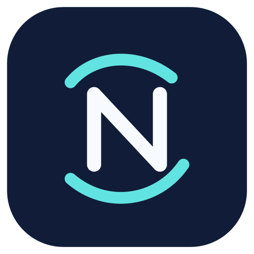

<h1>N-LIC · No Longer in Capsule</h1>
Android için açık kaynaklı ağ araştırma projesi

<a href="README.md">Русский</a> · <a href="README-en.md">English</a> · Türkçe

> **DENEYSEL — GÜVENLİK İNCELEMESİ SÜRÜYOR.** İlk N-LIC APK sürümleri Google Play Protect tarafından engellendi. Kesin neden henüz bilinmiyor. Yüklemek için cihaz korumasını kapatmayın. [Güvenlik incelemesi](docs/security/SECURITY_AUDIT_20261103.md).

N-LIC, [ByeByeDPI](https://github.com/romanvht/ByeByeDPI) projesinin bağımsız bir fork'udur. [ByeDPI](https://github.com/hufrea/byedpi) ve [hev-socks5-tunnel](https://github.com/heiher/hev-socks5-tunnel) bileşenlerini kullanır. Orijinal geliştiriciler tarafından onaylanmış bir sürüm değildir.

Uygulama, yerel SOCKS ve Android VPN yönlendirmesi üzerinden trafik işleme sağlar. **Uzak bir VPN değildir; tek başına trafiği şifrelemez veya IP adresinizi gizlemez.**

- [Codespaces geliştirici imzası](docs/CODESPACES_SIGNING.md)
- [Bağımsız sürüm imzası](docs/RELEASE_SIGNING.md)
- [Güvenlik raporu](docs/security/SECURITY_AUDIT_20261103.md)

Lisans GPL-3.0 — [LICENSE](LICENSE). Orijinal geliştiriciler: [romanvht](https://github.com/romanvht), [hufrea](https://github.com/hufrea), [heiher](https://github.com/heiher), [dovecoteescapee](https://github.com/dovecoteescapee).
