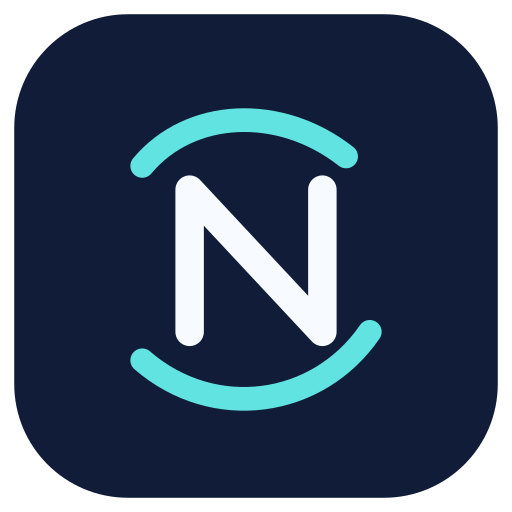

  
  <h1>N-LIC · No Longer in Capsule</h1>
  
Открытая исследовательская платформа для локальной обработки трафика и изучения DPI.

  
Русский · <a href="README-en.md">English</a> · <a href="README-tr.md">Türkçe</a>

> **Статус: экспериментальный форк, аудит безопасности продолжается.**
> Ранние сборки N-LIC были заблокированы Google Play Защитой. Причина не установлена.
> Не отключайте защиту устройства ради установки и не трактуйте смену бренда как решение проблемы.
> [Отчёт и план проверок](docs/security/SECURITY_AUDIT_20261103.md).

N-LIC основан на [ByeByeDPI](https://github.com/romanvht/ByeByeDPI) (Android-оболочка), [ByeDPI](https://github.com/hufrea/byedpi) (движок) и [hev-socks5-tunnel](https://github.com/heiher/hev-socks5-tunnel). Используется лицензия GPL-3.0, полный текст — [LICENSE](LICENSE). N-LIC — независимый форк и **не связан** с авторами исходного ByeByeDPI.

## Что умеет текущий код

- Локальный SOCKS5 и VPN-интерфейс Android для маршрутизации через ByeDPI.
- Редактор стратегий, локальные тесты, фильтрация приложений.
- Безопасный импорт/экспорт файлов через системный выбор Android.
- Отдельная идентичность N-LIC и раздельная подпись Dev/Release.

**Важно:** этот инструмент не является удалённым VPN. Сам по себе он не шифрует весь трафик и не скрывает ваш IP-адрес.

## Сборка и подпись

- [DEV-подпись и резервная копия в Codespaces](docs/CODESPACES_SIGNING.md).
- [Отдельная RELEASE-подпись](docs/RELEASE_SIGNING.md) — требует ручной подготовки и одобрения.
- Сборки через GitHub Actions, никогда не коммитьте `.p12`, ключи и пароли.
- Исходные нативные зависимости — Git submodules, клонируйте через `git clone --recurse-submodules`.

## Авторы исходной работы

- [romanvht](https://github.com/romanvht) — оригинальное приложение ByeByeDPI.
- [hufrea](https://github.com/hufrea) — ядро ByeDPI.
- [heiher](https://github.com/heiher) — hev-socks5-tunnel.
- [dovecoteescapee](https://github.com/dovecoteescapee) — ранняя реализация ByeDPIAndroid.

Мы сохраняем исходные авторские права и уважаем вклад разработчиков. Исправления, полезные upstream, планируем предлагать обратно.
